# GoAWAY — TVDEPT ride-hailing platform

[](https://github.com/Kotoliji/GoAWAY/actions/workflows/ci.yml)

A full-stack, Uber-style ride-hailing platform built around an **Oracle database
whose business rules live in PL/SQL**: driver assignment, fares, cancellation
fees, ratings, payouts and driver deactivation are procedures, functions and
triggers. On top of it:

- a **Node.js + TypeScript API** with JWT auth and real-time pushes (Socket.IO),
- a **React Native (Expo) mobile app** for riders and drivers,
- a **React admin panel** with KPIs, a live map, payouts and the analytical views,
- a **traffic simulator** that makes the whole system move for a demo.

**My role** — I built the platform end to end: the API, the mobile app, the
admin panel, the simulator, Docker, tests and CI. The Oracle database started
as a university project that I designed together with
[gltknebr](mailto:gltknebr@gmail.com).

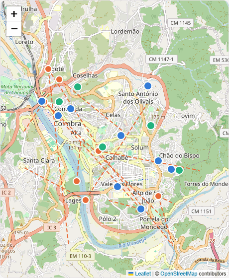

| Admin dashboard | Live map |
|---|---|
| 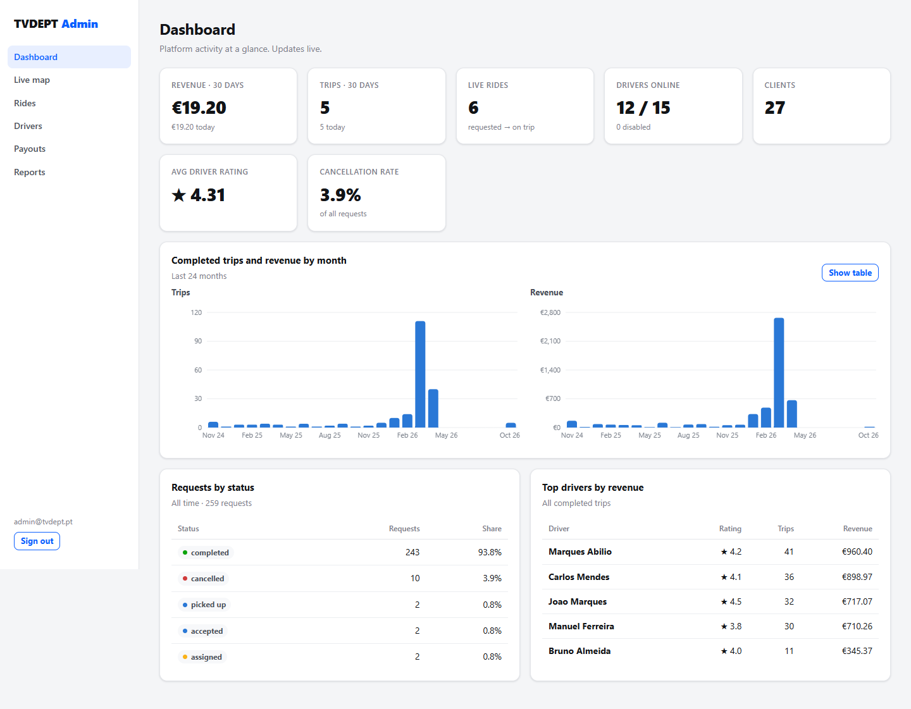 | 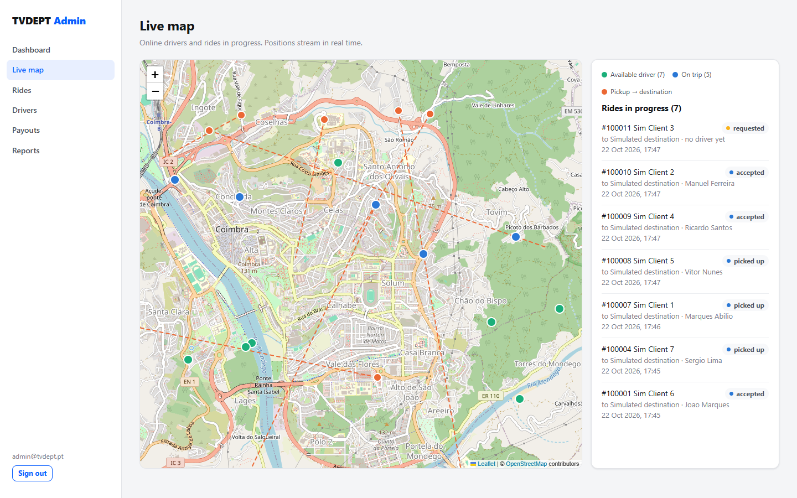 |
| **Drivers — payouts, disable / re-enable** | **Reports — the SQL analytical views** |
| 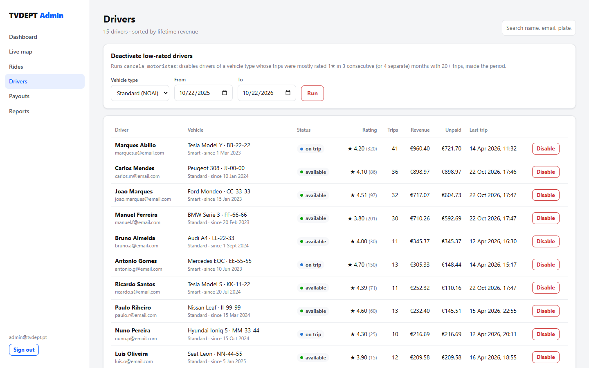 | 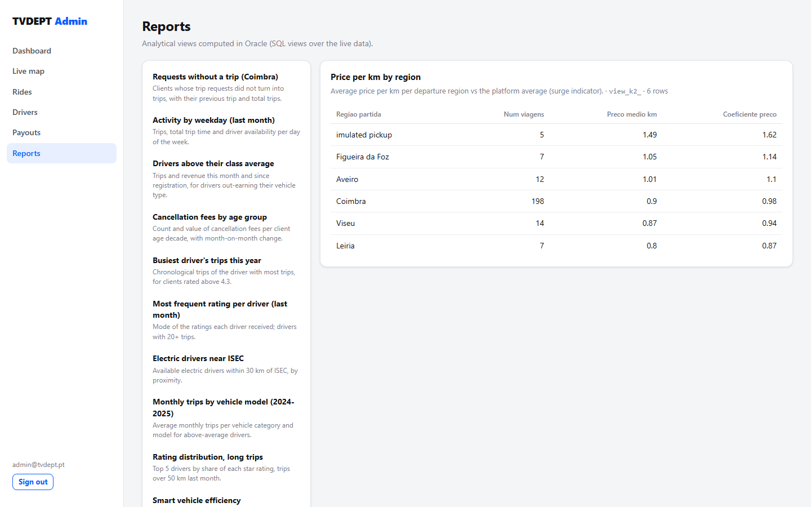 |

**Mobile app — rider:** free cars nearby, the fare before ordering, trip
history, and sign-up as a rider or as a driver with a vehicle:

<p>
  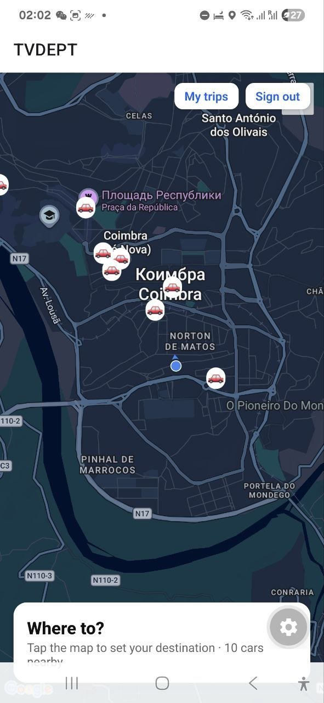
  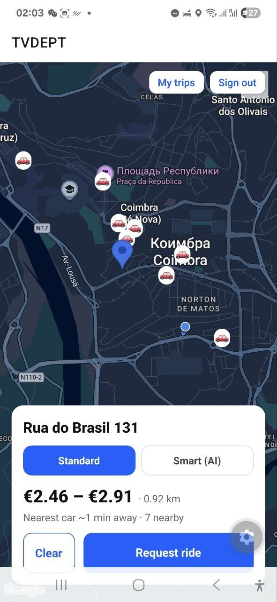
  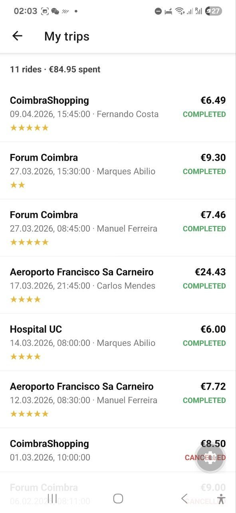
  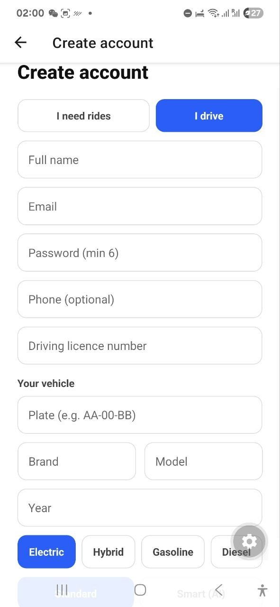
</p>

**Mobile app — driver:** online with today's earnings, a new request to accept
or decline, heading to the pickup, then on the trip:

<p>
  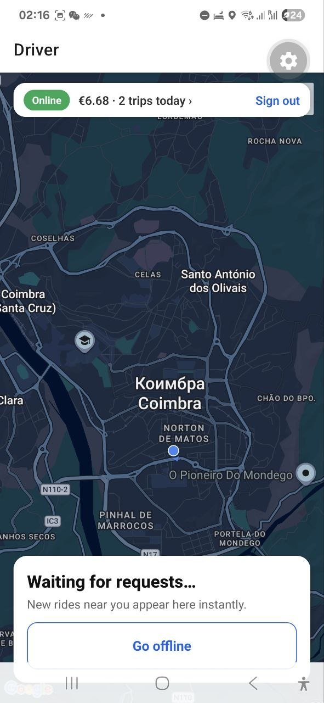
  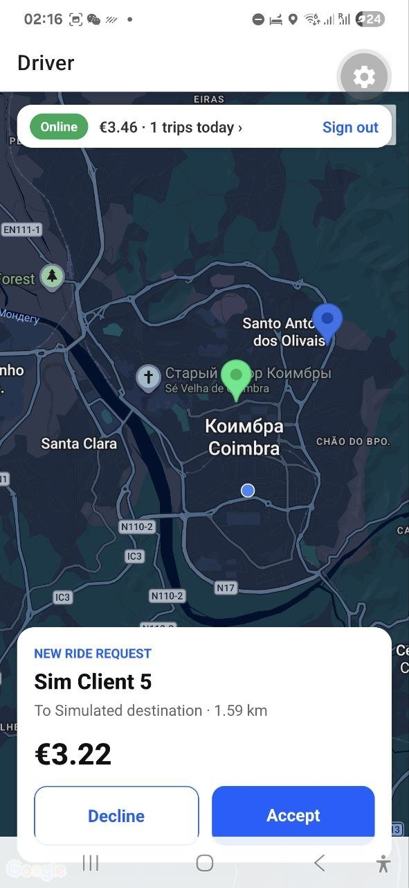
  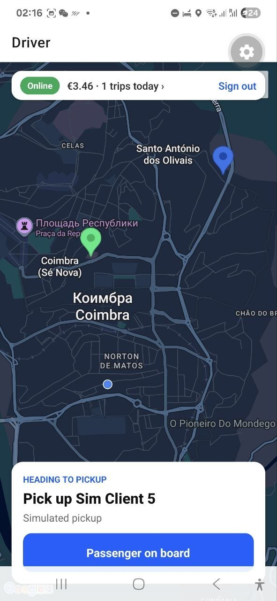
  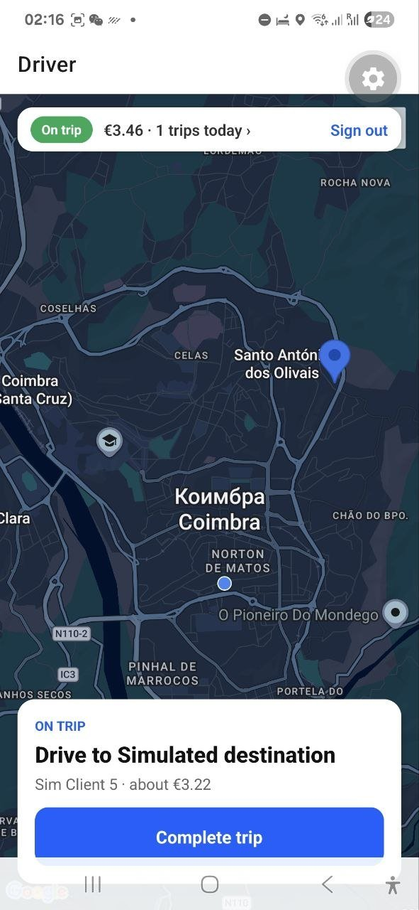
</p>

---

## What it does

**Rider (mobile)** — sees free cars nearby, picks a destination on the map and a
class (Standard / Smart), gets the **fare range and nearest-car ETA before
ordering**, follows the driver's car live on the map, can cancel (free until a
driver is assigned, fee shown before confirming), rates the trip, and keeps a
trip history.

**Driver (mobile)** — goes online, receives requests instantly (push +
vibration), accepts or declines (the request is re-offered to the next driver),
picks the passenger up and completes the trip; GPS is streamed while online and
today's earnings are always visible.

**Admin (browser)** — KPIs and monthly trends, a live map of every driver and
ride, all requests, drivers with unpaid balances, one-click payouts
(`paga_aos_motoristas`), disabling drivers or running the low-rating
deactivation rule (`cancela_motoristas`), and the 13 analytical SQL views.

## Architecture

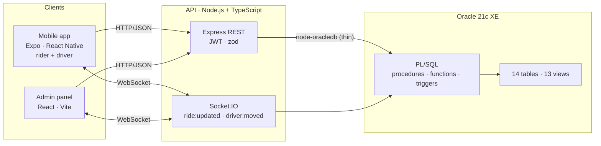

The API stays thin: it validates input, calls the PL/SQL layer and pushes the
result to whoever is affected. Every socket joins a personal room (and admins a
shared one), so a status change reaches exactly the rider, the driver and the
admin panel.

### Where the business logic lives

| Feature | Database object |
|---|---|
| Assign the nearest free driver of the right vehicle class, skipping drivers who declined or already hold a ride | `aloca_motorista` |
| Decline a request and re-offer it immediately | `app_driver_reject` |
| Go offline: refused mid-trip, held requests go back to the queue | `update_status` trigger |
| Trip end: free the driver, update shift totals | `viagem_Terminada` trigger |
| Fare quote before ordering (distance, fare range, drivers nearby) | `app_quote` |
| Cancellation fee: free until assigned, then the vehicle's tariff | `FN_CANCEL_FEE`, `SP_CANCEL_REQUEST` |
| Ratings: validated, one per trip, driver score updated | `cliente_Avalia`, `TRG_DRIVER_RATING_UPDATE`, `uq_client_rating_trip` |
| Sign-up: client, or driver + vehicle, with the login in one transaction | `app_register_client`, `app_register_driver` |
| Payouts net of commission | `paga_aos_motoristas` |
| Deactivate persistently 1-star drivers | `cancela_motoristas` |
| Audit of every request status change | `update_pedido` trigger |
| Status-transition and date integrity | `TRG_REQUEST_STATUS_GUARD`, `05_integrity.sql` |

## Tech stack

| Layer | Technologies |
|---|---|
| Database | Oracle 21c XE, SQL, PL/SQL |
| API | Node.js 24, TypeScript, Express, node-oracledb (thin mode), Socket.IO, JWT + rotating refresh tokens, bcrypt, zod |
| Mobile | Expo SDK 58, React Native 0.88, React 19, React Navigation 7, react-native-maps, expo-location, expo-secure-store |
| Admin | React 18, Vite, React Router, Recharts, Leaflet / OpenStreetMap |
| Ops | Docker Compose, nginx, GitHub Actions |

---

## Quick start

Requires Docker. One command builds the database, the API and the admin panel:

```bash
docker compose up -d --build --wait     # first run ~2 min: builds the schema
```

| | URL | Sign in |
|---|---|---|
| Admin panel | http://localhost:8080 | `admin@tvdept.pt` / `demo123` |
| API | http://localhost:3000/health | — |

**Make it move** — run the traffic simulator (needs Node.js 22+):

```bash
cd api && npm install && npm run simulate     # Ctrl+C to stop
```

Seeded drivers drive around Coimbra, simulated clients order rides, drivers
accept, pick up and drop off, clients rate — all through the public API, so the
dashboard and live map update in real time. To play a driver yourself in the
app, run `SIM_HUMAN=joao.marques@email.com npm run simulate`: that driver is left
to you and the simulated clients order rides next to your phone.

**Mobile app** — on a phone with [Expo Go](https://expo.dev/go), on the same
Wi-Fi as the computer:

```bash
cd app && npm install && npx expo start       # scan the QR code
```

The app finds the API on the computer that serves it; no IP to configure. Demo
logins (password `demo123`): rider `jose.lopes@email.com`, driver
`joao.marques@email.com` — or create an account in the app.

A standalone Android APK can be built with EAS (`app/eas.json`, profile
`preview`): `npx eas-cli build -p android --profile preview`.

Reset everything to a clean database: `docker compose down -v`.

## Testing

| What | How |
|---|---|
| PL/SQL smoke tests — every function, procedure and trigger, happy path and exceptions, all rolled back | `docker compose exec -w /opt/tvdept db bash -c "echo exit \| sqlplus -s tvdept/tvdept@//localhost/XEPDB1 @tests/smoke_tests.sql"` |
| End-to-end tests — 65 checks over HTTP and Socket.IO: driver, rider, dispatch and admin flows | `cd api && npm run test:e2e` (stack running) |
| CI — typecheck/build of API, admin and mobile app, `expo-doctor`; then Oracle + API in Docker, schema validity, smoke tests and the e2e suite | [`.github/workflows/ci.yml`](.github/workflows/ci.yml) |

The e2e suites each run in a different Portuguese city, so they never pick up
each other's drivers or the simulator's.

---

## Repository structure

```
├── database/                 Oracle schema, data, views, PL/SQL (see below)
├── api/                      Express + TypeScript API, Socket.IO, simulator, e2e tests
├── app/                      Expo / React Native mobile app (rider + driver)
├── admin/                    React + Vite admin panel
├── docker-compose.yml        Oracle XE + API + admin
├── docker/db-init/           builds the schema on the database's first start
├── model/                    data model (DBML) and ER diagram (draw.io)
├── docs/screenshots/         images used in this README
└── .github/workflows/ci.yml  CI
```

Each part has its own README: [`api/`](api/README.md) (endpoints, events),
[`app/`](app/README.md), [`admin/`](admin/README.md).

## The database

```
database/
├── 00_setup_user.sql        application user (manual installs; Docker creates it)
├── 01_schema/tables.sql     14 tables + PK/FK/CHECK constraints
├── 02_data/insert_data.sql  sample dataset (Coimbra region)
├── 03_views/views.sql       13 analytical views
├── 04_plsql/                functions, procedures, triggers, integrity, storage tuning
├── 05_app/                  application layer: auth tables, sign-up, driver,
│                            rider, admin procedures, demo logins
├── install.sql              builds everything in order, reports invalid objects
└── tests/smoke_tests.sql    exercises every object (rolls back)
```

**Schema:** client, driver, vehicle, driver_vehicle, tariff, driver_schedule,
location, trip_request, trip_preferences, trip, client_rating, driver_rating,
driver_payment, trip_process — plus app_user, refresh_token and device for the
application.

**Functions:** `distancia_linear` (Haversine distance), `motorista_mais_proximo`,
`valor_medio_diario`, `data_ultima_viagem`, `distancia_entre`,
`distancia_das_viagens`, `FN_DRIVER_MONTHLY_NET`, `FN_REQUEST_DISTANCE`,
`FN_CANCEL_FEE`.

**Procedures:** `aloca_motorista`, `paga_aos_motoristas`, `cancela_motoristas`,
`SP_REGISTER_DRIVER_PAYMENT`, `SP_CANCEL_REQUEST`, and the application
procedures `app_register_*`, `app_driver_*`, `app_quote`,
`app_admin_set_driver_status`.

**Triggers:** `update_status`, `cliente_Avalia`, `viagem_Terminada`,
`update_pedido`, `TRG_DRIVER_RATING_UPDATE`, `TRG_REQUEST_STATUS_GUARD`, and
date-integrity triggers.

**Integrity & tuning:** CHECK constraints for money, distances, durations, date
ordering and payment consistency (`net = gross − commission`); PCTFREE/INITRANS
storage parameters for the fastest-growing tables.

**Manual install** (without Docker), on Oracle 21c XE:

```bash
sqlplus / as sysdba @database/00_setup_user.sql
sqlplus tvdept/tvdept @database/install.sql
sqlplus tvdept/tvdept @database/tests/smoke_tests.sql
```

Open `model/tvdept.dbml` at [dbdiagram.io](https://dbdiagram.io) for the physical
model and `model/er-diagram.drawio` at [draw.io](https://app.diagrams.net) for the
ER diagram.

> Passwords and the JWT secret in this repository are local demo values — change
> them before any real deployment.

---

## Authors

- kirill30082005@gmail.com — author
- gltknebr@gmail.com — co-author of the database

## License

[MIT](LICENSE)
